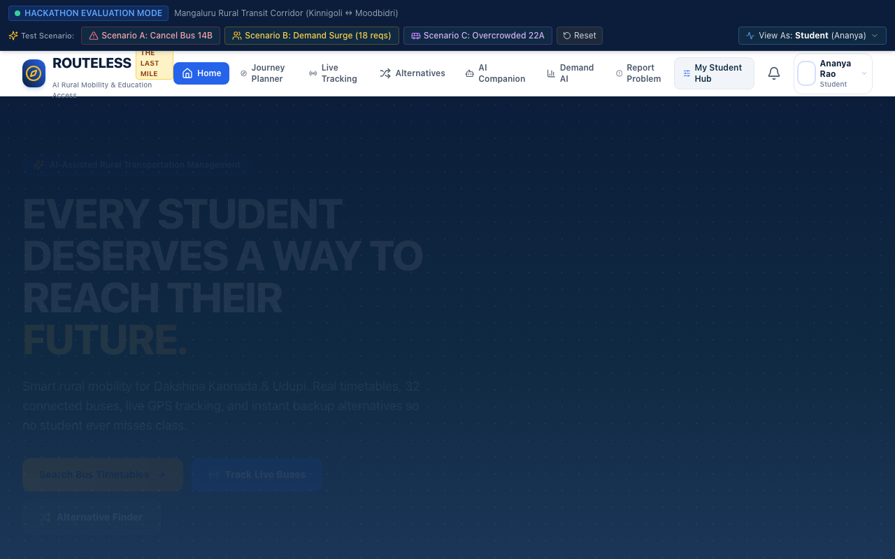
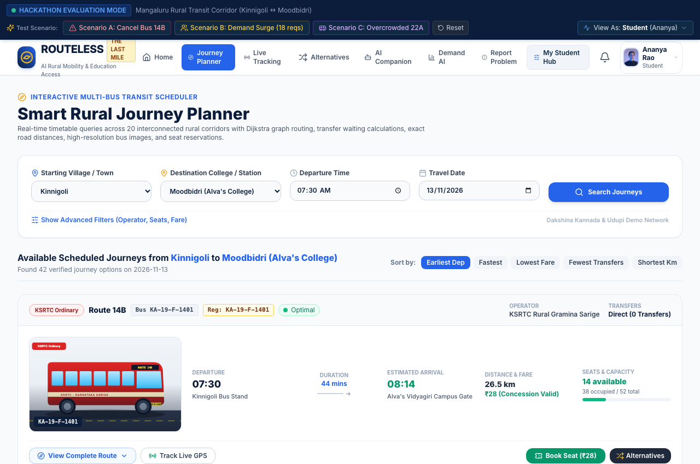
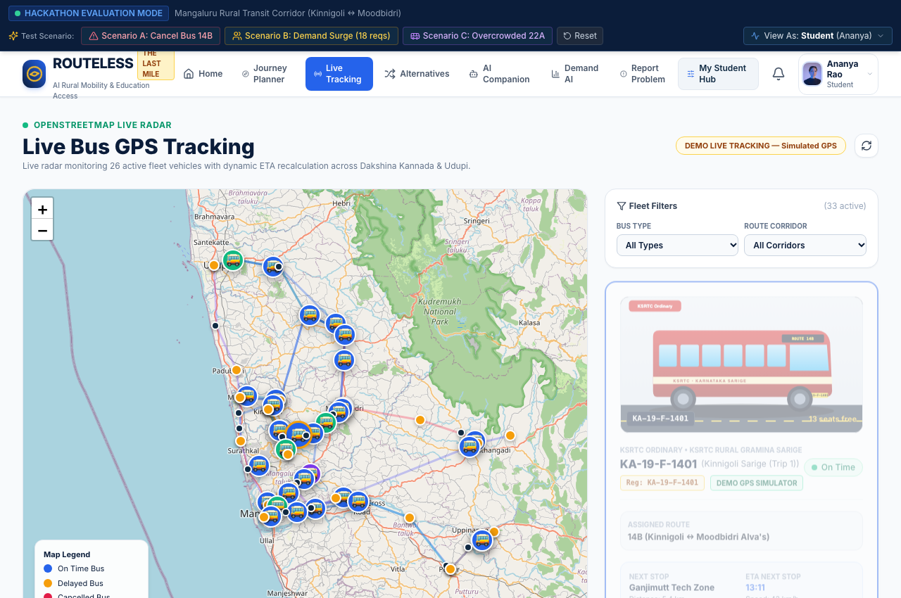
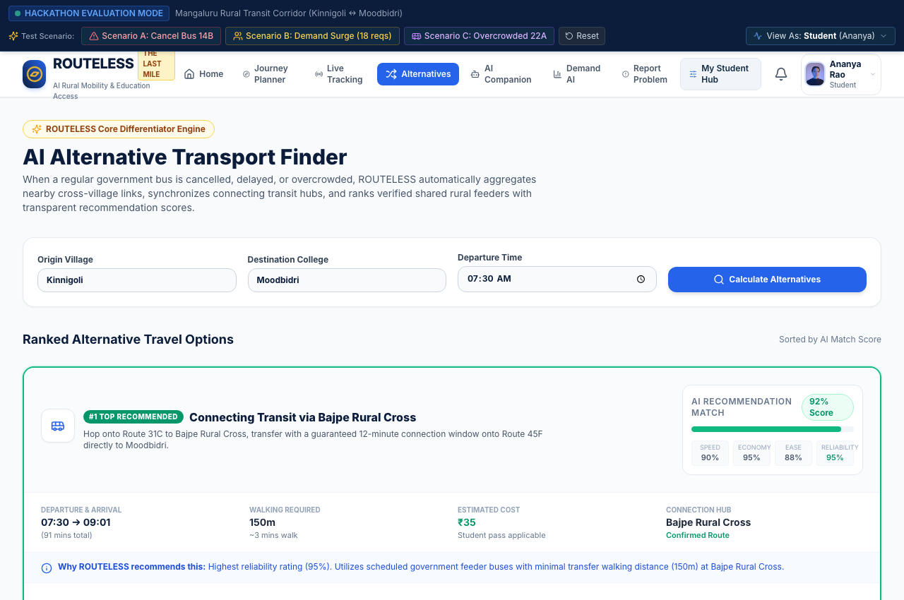
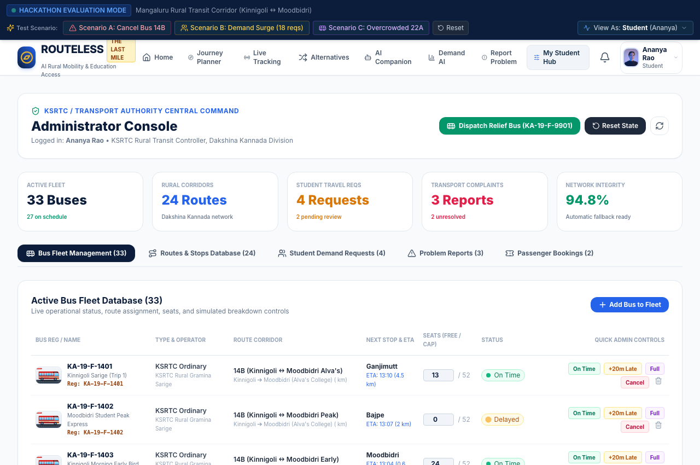
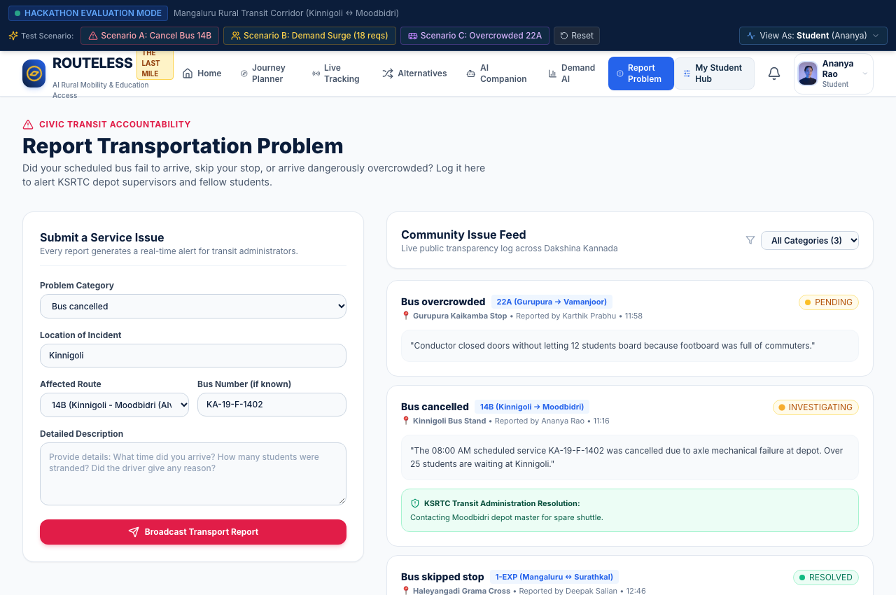
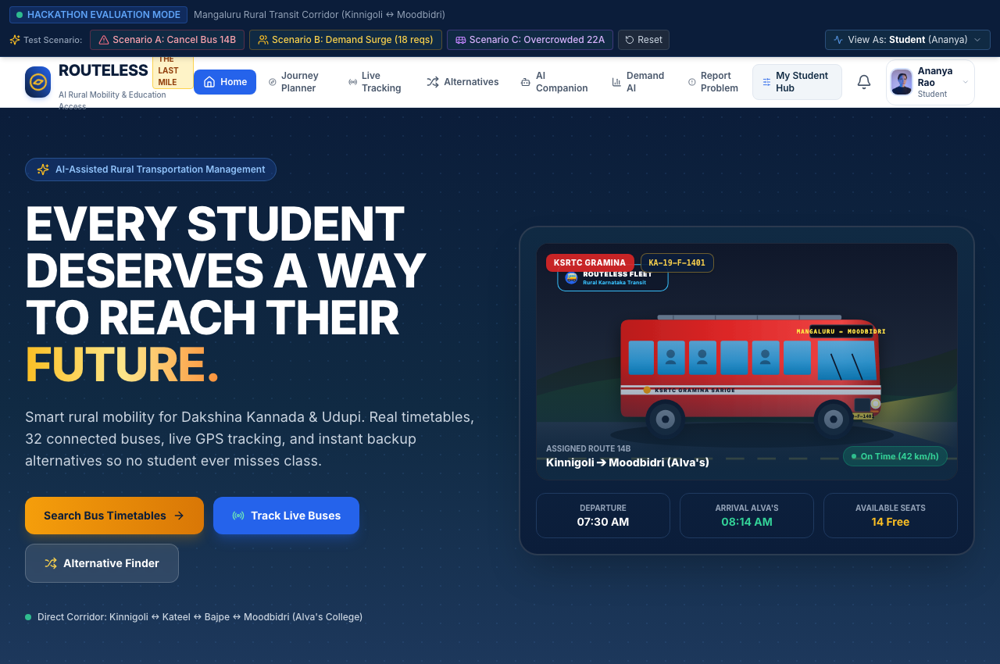

# ROUTELESS – THE LAST MILE
### AI-Powered Rural Transportation Management & Smart Mobility Platform

> **"No Bus Should Mean No Missed Futures."**

[](https://reactjs.org/)
[](https://vitejs.dev/)
[](https://www.typescriptlang.org/)
[](https://tailwindcss.com/)
[](https://expressjs.com/)
[](https://www.sqlite.org/)
[](https://leafletjs.com/)
[](https://www.framer.com/motion/)
[](https://recharts.org/)
[](https://opensource.org/licenses/MIT)

---

## 📌 Table of Contents
1. [Project Overview](#1-project-overview)
2. [The Core Problem](#2-the-core-problem)
3. [Our Solution](#3-our-solution)
4. [Screenshots](#4-screenshots)
5. [Key Implemented Features](#5-key-implemented-features)
6. [Technology Stack](#6-technology-stack)
7. [System Architecture & Algorithms](#7-system-architecture--algorithms)
8. [Database Engine & Schema](#8-database-engine--schema)
9. [Complete API Endpoints Reference](#9-complete-api-endpoints-reference)
10. [Hackathon Demonstration & Verification Guide](#10-hackathon-demonstration--verification-guide)
11. [Installation & Setup](#11-installation--setup)
12. [Demonstration Geographic Coverage](#12-demonstration-geographic-coverage)
13. [Future Roadmap](#13-future-roadmap)
14. [License](#14-license)

---

## 1. Project Overview

**ROUTELESS — THE LAST MILE** is an intelligent, full-stack rural transportation management platform designed to ensure that rural students never miss exams, laboratory sessions, or career opportunities due to cancelled buses, irregular timetables, overcrowding, or invisible transit alternatives.

Built specifically for high-density student transit corridors—modeled after coastal Karnataka (**Dakshina Kannada & Udupi: Kinnigoli, Kateel, Bajpe, Moodbidri, Karkala, Surathkal, Bantwal**)—ROUTELESS unifies students, bus operators, and transport administrators into one coherent ecosystem.

- **Primary Beneficiaries**: Rural students traveling from interior villages to major academic centers (**Alva's Education Foundation Moodbidri**, **NITK Surathkal**, **St. Joseph Engineering College Vamanjoor**, **Canara Engineering College Benjanapadavu**, **SDM Ujire**, and **MAHE Manipal**).
- **Project Classification**: AI-Powered Rural Transportation Management & Smart Mobility Platform.
- **Hackathon Status**: Fully implemented, self-contained, working prototype with connected SQLite database, graph route optimization, real-time simulated GPS tracking, seat booking engine, and administrative dispatch tools.

---

## 2. The Core Problem

In rural India, millions of students depend daily on a fragile, limited schedule of public and private buses to travel between their homes in village interiors and higher educational institutions in nearby towns.

### Real-World Realities Faced by Rural Students:
- **Infrequent Morning Services**: Often only 1 or 2 buses pass through an interior village between 06:30 AM and 08:30 AM.
- **Unannounced Delays & Cancellations**: Mechanical breakdowns or road blockages leave students stranded at rural junctions without advance notice.
- **Extreme Overcrowding (Full Capacity)**: Buses arrive packed with footboard passengers and bypass village stops entirely.
- **Information Blackout**: Students have no reliable, centralized tool to discover alternative routes, parallel walking connections, or cross-village transit hubs.
- **Zero Visibility for Transport Depots**: Depots only discover that 50+ students missed an examination hours after the crisis occurred, lacking real-time demand aggregation to justify relief bus dispatch.

---

## 3. Our Solution

ROUTELESS transforms rural student transit from an unpredictable gamble into an orchestrated, transparent, and resilient network:

```
┌────────────────────────────────────────────────────────────────────────┐
│                   ROUTELESS SOLUTION ARCHITECTURE                      │
├────────────────────────────────┬───────────────────────────────────────┤
│ 1. Graph Route Optimization    │ Dijkstra shortest-path engine with    │
│    (Dijkstra Algorithm)        │ multi-transfer synchronization        │
├────────────────────────────────┼───────────────────────────────────────┤
│ 2. Disruption Recovery Engine  │ Automatic alternative finder with     │
│    (100-Point Composite Score) │ walking hubs, shared maxicabs & pools │
├────────────────────────────────┼───────────────────────────────────────┤
│ 3. Live Radar & GPS Telemetry  │ OpenStreetMap/Leaflet bus tracking    │
│    (Simulated Waypoint Engine) │ with live speed, heading & seat stats │
├────────────────────────────────┼───────────────────────────────────────┤
│ 4. Fleet & Demand Management   │ Real-time student request clustering  │
│    (Persistent SQLite Engine)  │ and 1-click relief shuttle dispatch   │
└────────────────────────────────┴───────────────────────────────────────┘
```

---

## 4. Screenshots

The following screenshots are captured directly from the live running ROUTELESS web application:

### Homepage
*Hero section with instant journey search widget, live fleet counters, problem overview, and core feature navigation.*



---

### Smart Journey Planner
*Multi-bus schedule planning displaying verified direct and synchronized connecting options, stop-level timelines, fare calculation, and real-time available seat counters.*



---

### Live Bus Radar & Telemetry
*Interactive OpenStreetMap radar showing real-time bus locations, directional headings, speed gauges, next stop ETAs, and capacity indicators.*



---

### Alternative Transport Finder
*Intelligent disruption recovery: when regular buses are cancelled or full, ranks 4 multi-modal alternatives using the 100-point composite scoring formula.*



---

### Administrator Operations Console
*Depot management dashboard with fleet health metrics, active routes, bus registration, timetable schedule editor, and relief vehicle dispatch.*



---

### Crowdsourced Problem Reporting
*Public transit transparency portal where students submit geotagged issues (skipped stops, delays, overcharging) with admin resolution tracking.*



---

### Student Portal & Pass Manager
*Personalized student command center showing active digital bus concession pass, upcoming seat reservations, travel history, and emergency alerts.*



---

## 5. Key Implemented Features

### 🚌 1. Smart Journey Planner
- **Dijkstra Graph Traversal**: Computes direct journeys and synchronized 1-transfer connections across the regional transit graph.
- **Timetable-Aware Stop Offsets**: Calculates accurate departure and arrival times at intermediate rural stops based on distance and route duration.
- **Layover Buffers**: Ensures multi-leg connections have realistic transfer windows (3 to 60 minutes) at transit hubs like Bajpe, Moodbidri, and Belman.
- **Multi-Factor Filtering & Sorting**: Filter by bus type (KSRTC Ordinary, Express, Private, College Shuttle, Shared Feeder), maximum fare, minimum available seats, and sort by *Earliest Departure*, *Fastest*, *Cheapest*, or *Fewest Transfers*.

### 🔄 2. Multi-Bus Route Search
- Full demonstration database of **24 interconnected routes** and **56 regional bus stops** covering coastal Karnataka.
- Bidirectional corridor support ensuring direct and connecting options are discovered regardless of whether the student travels northbound, southbound, or cross-country.

### 🛡️ 3. Alternative Route Finder (Core Innovation)
When a student's regular bus is delayed, cancelled, or running at 100% capacity:
- Automatically detects the disrupted service.
- Calculates and ranks **4 multi-modal backup options**:
  1. *Parallel Connecting Bus via Hub* (transfer at nearby town).
  2. *Walk to Parallel Cross-Village Stop* (e.g. 800m walk to bypass junction).
  3. *Verified Shared Rural Maxicab / Feeder* (Gramina Cruiser union vehicles).
  4. *Verified Student Pooling / Carpool* (shared group rides).
- Uses the **100-Point Composite Score Formula**:
  $$\text{Score} = (w_t \cdot S_{\text{time}}) + (w_c \cdot S_{\text{cost}}) + (w_e \cdot S_{\text{ease}}) + (w_r \cdot S_{\text{reliability}})$$

### 📡 4. Live GPS Bus Tracking Radar
- Built with **Leaflet** and **OpenStreetMap**.
- Real-time simulated GPS telemetry updating bus coordinates, directional heading, speed (km/h), and stop-to-stop ETA.
- Interactive bus selection panel displaying driver contact, current delay status, remaining distance, and route polylines.

### 💺 5. Passenger & Real-Time Seat Availability
- Live seat inventory: Tracks total capacity, occupied seats, and available seats for all 33 fleet buses.
- **Seat Booking Pipeline**: Students can book a confirmed seat on any scheduled trip with an instant booking voucher reference.
- **Atomic Inventory Updates**: Booking decrements available seats on both the bus and trip records in SQLite; cancellation restores the inventory.

### 🤖 6. ROUTELESS AI Transportation Assistant
- Context-aware virtual travel assistant.
- Evaluates live route statuses, delay reports, and backup itineraries to answer student questions in natural language.
- Includes quick-prompt pills: *"Find backup for cancelled bus"*, *"Show buses to Alva's College"*, *"How to reach Karkala from Kinnigoli"*.

### 📊 7. Demand Prediction & Relief Shuttle Dispatch
- Aggregates student travel requests and flags supply-demand deficits.
- Displays morning exam surge curves using **Recharts**.
- Provides a 1-click **"Dispatch Relief Shuttle"** button for depot managers to allocate standby KSRTC buses and clear backlogged student queues.

### 📢 8. Crowdsourced Problem Reporting
- Community-driven feedback portal where students report transit failures (skipped village stop, bus breakdown, rash driving, overcharging).
- Categorized status tracking (*Open*, *Under Review*, *Resolved*) with administrative notes.

### 🛠️ 9. Administrator & Fleet Management Console
- Full CRUD capabilities for fleet buses: register new vehicles, update route assignments, modify seat capacities, and toggle maintenance status.
- Route management: inspect ordered stop sequences, distance breakdowns, and associated schedules.
- Live system status monitors database health, active trips, and fleet telemetry.

### 🎮 10. Persistent Hackathon Evaluation Bar
A persistent banner at the top of the interface provides 1-click triggers for live evaluation scenarios:
- **Scenario A**: Immediately cancels Bus `KA-19-F-1402` on Route 14B to test alternative recovery.
- **Scenario B**: Injects an 18-passenger student demand surge on the Kinnigoli-Moodbidri corridor to demonstrate demand prediction and relief dispatch.
- **Scenario C**: Marks Bus `KA-19-F-2201` as Overcrowded (0 seats available) to test full-capacity rerouting.
- **Reset Demo**: Instantly restores the database to pristine baseline conditions.

---

## 6. Technology Stack

### Frontend Client
| Technology | Version | Purpose |
| :--- | :--- | :--- |
| **React** | `^18.3.1` | Component-based interactive UI library |
| **Vite** | `^6.0.3` | High-speed frontend build tool & development server |
| **TypeScript** | `~5.6.2` | Type-safe application development |
| **Tailwind CSS** | `^3.4.17` | Utility-first responsive styling |
| **Framer Motion** | `^11.15.0` | Fluid animations, card reveals, and transitions |
| **Lucide React** | `^0.468.0` | Clean, modern iconography |
| **Leaflet & React-Leaflet** | `^1.9.4` / `^4.2.1` | Interactive maps, tile layers, and vehicle radar |
| **Recharts** | `^2.15.0` | Data visualization for passenger demand prediction |
| **React Router DOM** | `^6.28.0` | Client-side routing and deep-linking |

### Backend API
| Technology | Version | Purpose |
| :--- | :--- | :--- |
| **Node.js** | `v22+` / `v26` | Server runtime environment |
| **Express** | `^4.21.2` | RESTful API server framework |
| **TypeScript** | `^5.7.2` | Strongly typed backend services and models |
| **Node SQLite (`node:sqlite`)** | Native Built-in | Persistent, high-performance database with WAL mode |
| **CORS** | `^2.8.5` | Cross-Origin Resource Sharing middleware |
| **dotenv** | `^16.4.7` | Environment configuration management |
| **UUID** | `^11.0.5` | Unique identifier generation for bookings and reports |

---

## 7. System Architecture & Algorithms

```text
┌─────────────────────────────────────────────────────────────────────────────┐
│                          ROUTELESS SYSTEM TOPOLOGY                          │
└─────────────────────────────────────────────────────────────────────────────┘

       [ Students / Mobile Web ]     [ KSRTC Depot Admins ]     [ Bus Operators ]
                   │                            │                       │
                   └─────────────────┬──────────┴───────────────────────┘
                                     │ (Vite Proxy: /api -> http://127.0.0.1:5001)
                                     ▼
                   ┌───────────────────────────────────┐
                   │       Express REST API Server     │
                   │           (Node.js / TS)          │
                   └─────────────────┬─────────────────┘
                                     │
           ┌─────────────────────────┼─────────────────────────┐
           ▼                         ▼                         ▼
┌─────────────────────┐   ┌─────────────────────┐   ┌─────────────────────┐
│   Dijkstra Graph    │   │ Multi-Modal Scorer  │   │  GPS Simulator      │
│  Path Optimization  │   │ Alternative Engine  │   │  (3.5s Telemetry)   │
└──────────┬──────────┘   └──────────┬──────────┘   └──────────┬──────────┘
           │                         │                         │
           └─────────────────────────┼─────────────────────────┘
                                     ▼
                   ┌───────────────────────────────────┐
                   │    SQLite Persistent Database     │
                   │    (Native DatabaseSync in WAL)   │
                   │   data/routeless.sqlite (67 trips)│
                   └───────────────────────────────────┘
```

### Dijkstra Multi-Transfer Pathfinding Algorithm
The routing engine models the regional bus network as a directed weighted multigraph:
1. **Direct Buses**: Evaluates each route where `fromIdx < toIdx`. Computes exact intermediate boarding times using route stop sequence offsets:
   $$\text{Boarding Time} = \text{Departure}_{\text{route}} + \left(\frac{\text{Duration}_{\text{route}}}{N_{\text{stops}} - 1} \times \text{fromIdx}\right)$$
2. **Connecting Transfers**: Performs 2-hop graph traversal through intermediate interchange hubs ($H$). Validates transfer feasibility using chronological layover constraints:
   $$3\text{ mins} \le \text{Departure}_{\text{leg2}}(H) - \text{Arrival}_{\text{leg1}}(H) \le 60\text{ mins}$$
3. **Multi-Factor Journey Ranking**: Sorts candidate itineraries by user preference while penalizing delays and transfer counts.

---

## 8. Database Engine & Schema

ROUTELESS uses Node's native `DatabaseSync` (`node:sqlite`) with **Write-Ahead Logging (WAL)** mode for persistent, high-concurrency local storage.

- **Database File**: `backend/data/routeless.sqlite`
- **Concurrency Mode**: `PRAGMA journal_mode = WAL; PRAGMA busy_timeout = 5000;`

### Relational Schema Summary:
```sql
-- Core Fleet
CREATE TABLE buses (
  id TEXT PRIMARY KEY,
  busNumber TEXT,
  registrationNumber TEXT,
  busName TEXT,
  busType TEXT,
  operator TEXT,
  routeId TEXT,
  capacity INTEGER,
  occupiedSeats INTEGER,
  availableSeats INTEGER,
  currentLat REAL,
  currentLng REAL,
  status TEXT
);

-- Transit Routes
CREATE TABLE routes (
  id TEXT PRIMARY KEY,
  routeNumber TEXT,
  routeName TEXT,
  origin TEXT,
  destination TEXT,
  distanceKm REAL,
  estimatedDurationMin INTEGER,
  fareRupees REAL,
  operatingDays TEXT,
  stops_json TEXT,
  schedule_json TEXT
);

-- Scheduled Trips
CREATE TABLE trips (
  id TEXT PRIMARY KEY,
  tripNumber TEXT,
  routeId TEXT,
  busId TEXT,
  departureTime TEXT,
  arrivalTime TEXT,
  durationMin INTEGER,
  fareRupees REAL,
  capacity INTEGER,
  availableSeats INTEGER,
  status TEXT
);

-- Bus Stops & Regional Hubs
CREATE TABLE stops (
  id TEXT PRIMARY KEY,
  name TEXT,
  latitude REAL,
  longitude REAL,
  sequence INTEGER,
  villageTag TEXT,
  aliases_json TEXT,
  isHub INTEGER DEFAULT 0
);

-- Student Seat Bookings
CREATE TABLE bookings (
  id TEXT PRIMARY KEY,
  bookingReference TEXT UNIQUE,
  tripId TEXT,
  busId TEXT,
  fromStop TEXT,
  toStop TEXT,
  departureTime TEXT,
  travelDate TEXT,
  studentId TEXT,
  passengerName TEXT,
  seatNumber INTEGER,
  farePaid REAL,
  status TEXT
);

-- Crowdsourced Reports & Demand Requests
CREATE TABLE reports (id TEXT PRIMARY KEY, category TEXT, description TEXT, status TEXT, ...);
CREATE TABLE requests (id TEXT PRIMARY KEY, origin TEXT, destination TEXT, passengerCount INTEGER, ...);
CREATE TABLE notifications (id TEXT PRIMARY KEY, targetRole TEXT, title TEXT, message TEXT, ...);
```

---

## 9. Complete API Endpoints Reference

### Journey Planning & Routes
| Method | Endpoint | Description |
| :--- | :--- | :--- |
| `GET` | `/api/journey/plan` | Plan multi-bus journey with origin, destination, time, date, and filters |
| `GET` | `/api/journey/search` | Alias for journey plan endpoint |
| `GET` | `/api/journey/routes` | List all 24 regional transit routes |
| `GET` | `/api/journey/routes/:id` | Get details and stop sequence for a specific route |
| `POST` | `/api/journey/routes` | Create new transit route (Admin) |
| `PATCH` | `/api/journey/routes/:id` | Update route details or schedule (Admin) |
| `DELETE`| `/api/journey/routes/:id` | Remove route from database (Admin) |

### Fleet & Live Telemetry
| Method | Endpoint | Description |
| :--- | :--- | :--- |
| `GET` | `/api/buses` | Get all fleet buses (filters: `routeId`, `busType`, `status`) |
| `GET` | `/api/buses/:id` | Get single bus by ID or registration number |
| `POST` | `/api/buses` | Register a new bus to the fleet (Admin) |
| `PATCH` | `/api/buses/:id` | Update bus details, delay, or status |
| `DELETE`| `/api/buses/:id` | Remove bus from active fleet |
| `POST` | `/api/buses/:id/telemetry` | Ingest real-time GPS coordinates, speed, and heading |
| `GET` | `/api/buses/:id/location` | Fetch current GPS location and next stop ETA |

### Seat Booking Engine
| Method | Endpoint | Description |
| :--- | :--- | :--- |
| `GET` | `/api/bookings` | List all confirmed seat bookings (or filter by `studentId`) |
| `POST` | `/api/bookings` | Create new booking, decrement available seat count |
| `POST` | `/api/bookings/:id/cancel` | Cancel booking and release seat back to fleet inventory |

### Alternative Recovery & AI
| Method | Endpoint | Description |
| :--- | :--- | :--- |
| `GET` | `/api/alternatives` | Compute multi-modal backup options for a disrupted journey |
| `POST` | `/api/ai/chat` | AI journey assistant answering student queries |

### Evaluation Scenarios & Administration
| Method | Endpoint | Description |
| :--- | :--- | :--- |
| `POST` | `/api/demo/scenario-a` | Trigger Scenario A: Mark Bus 14B as Cancelled |
| `POST` | `/api/demo/scenario-b` | Trigger Scenario B: Inject 18 student surge requests |
| `POST` | `/api/demo/scenario-c` | Trigger Scenario C: Mark Bus 22A as Overcrowded |
| `POST` | `/api/demo/reset` | Restore baseline demonstration state |
| `GET` | `/api/reports` | Get all crowdsourced incident reports |
| `POST` | `/api/reports` | Submit new incident report (delayed/skipped bus) |
| `PATCH` | `/api/reports/:id` | Resolve report with depot resolution note |
| `GET` | `/api/requests` | List student travel demand aggregation requests |
| `GET` | `/api/notifications` | Fetch role-based system notifications |

---

## 10. Hackathon Demonstration & Verification Guide

### 1-Click Demo Accounts (Instant Role Switching)
Use the demo selector on the top navigation bar or log in with these pre-seeded accounts:

| Role | Name | Email | Password | Primary Capabilities |
| :--- | :--- | :--- | :--- | :--- |
| **Student** | Ananya Rao | `student@routeless.org` | `password123` | Plan journeys, book seats, track live buses, request relief, report problems |
| **Depot Admin** | K. R. Hegde | `admin@routeless.org` | `adminpassword` | Fleet overview, schedule editor, dispatch relief shuttles, resolve reports |
| **Bus Operator** | Suresh Naik | `operator@routeless.org` | `driverpassword` | Update live trip delays, broadcast seat capacity, toggle breakdowns |

---

### Key Demonstration Queries to Test:

#### Query 1: Kinnigoli to Moodbidri (Alva's College)
- **Origin**: `Kinnigoli`
- **Destination**: `Moodbidri (Alva's College)`
- **Departure Time**: `07:30 AM`
- **Travel Date**: `13/11/2026`
- **Expected Results**: **42 verified options** (8 Direct services, 34 synchronized transfers via Bajpe/Kateel). Direct service departs 07:30, arrives 08:14 (44 mins, fare ₹28, 14 free seats).

#### Query 2: Kinnigoli to Karkala Bus Stand
- **Origin**: `Kinnigoli`
- **Destination**: `Karkala Bus Stand`
- **Departure Time**: `07:30 AM`
- **Travel Date**: `13/11/2026`
- **Expected Results**: **44 verified options** (6 Direct return services on Route 66K, 38 transfers via Bajpe/Moodbidri). Direct option departs 07:32, arrives 08:07 (35 mins, fare ₹27).

---

## 11. Installation & Setup

### Prerequisites
- **Node.js**: `v18.0.0` or higher (tested on Node `v22` and `v26`)
- **npm**: `v9.0.0` or higher
- **Git**

### Step 1: Clone the Repository
```bash
git clone https://github.com/your-username/routeless.git
cd routeless
```

### Step 2: Install All Dependencies
```bash
# Installs root, backend, and frontend dependencies in one command
npm run install:all
```

### Step 3: Run the Development Servers
Open two terminal windows:

**Terminal 1 — Backend API Server:**
```bash
npm run dev:backend
# Starts Express server on http://localhost:5001 with SQLite WAL mode
```

**Terminal 2 — Frontend Client:**
```bash
npm run dev:frontend
# Starts Vite React dev server on http://localhost:5173
```

Open your browser and navigate to:
```
http://localhost:5173
```

### Production Build Verification
```bash
# Verify type-checking and production bundling
npm run build:frontend
```

---

## 12. Demonstration Geographic Coverage

The demonstration network is grounded in authentic coordinates across coastal Karnataka:

| Stop / Landmark | Taluk / Region | Latitude | Longitude | Primary Connections |
| :--- | :--- | :---: | :---: | :--- |
| **Kinnigoli Bus Stand** | Mangaluru Rural | `13.0854` | `74.8722` | Hub for Kateel, Mulki, Moodbidri |
| **Kateel Temple Junction** | Mangaluru Rural | `13.0673` | `74.8488` | Pilgrimage & student feeder interchange |
| **Bajpe Rural Hub** | Mangaluru Rural | `12.9818` | `74.8872` | Critical transfer junction for Karkala & Moodbidri |
| **Moodbidri Bus Terminus** | Moodbidri Taluk | `13.0722` | `74.9961` | Main terminus for Alva's Educational Institutions |
| **Alva's Vidyagiri Gate** | Moodbidri | `13.0650` | `74.9890` | Campus gate stop serving 25,000+ students |
| **Karkala Bus Stand (Bandimath)** | Karkala Taluk | `13.2130` | `74.9980` | Udupi / Western Ghats gateway |
| **NITK Surathkal Main Gate** | Surathkal | `13.0076` | `74.7946` | National Institute of Technology campus stop |
| **Vamanjoor (St. Joseph Engg)**| Mangaluru | `12.9197` | `74.8967` | Engineering college corridor |
| **Bantwal BC Road Bus Stand** | Bantwal Taluk | `12.8931` | `75.0352` | National Highway 73 / 75 intersection |
| **Udupi Service Bus Stand** | Udupi District | `13.3409` | `74.7421` | Central coastal transit terminus |

---

## 13. Future Roadmap

1. **Karnataka KSRTC Sarige QR Integration**: Seamless digital student concession passes and UPI dynamic QR ticketing.
2. **Offline-First PWA & USSD Fallback**: Low-bandwidth Progressive Web App with SMS/USSD inquiry support for 2G rural pockets.
3. **Driver Telemetry Native Mobile App**: Real-time driver companion application utilizing native smartphone GPS and accelerometer data.
4. **Multi-Lingual Audio Interface**: Voice-assisted journey planning in **Kannada (ಕನ್ನಡ)**, **Tulu (ತುಳು)**, and **Konkani (ಕೊಂಕಣಿ)**.

---

## 14. License

Distributed under the **MIT License**. See `LICENSE` for more information.

---

<div align="center">
  <sub>Built with ❤️ for rural education accessibility. <b>ROUTELESS — Every Student Deserves a Way to Reach Their Future.</b></sub>
</div>
